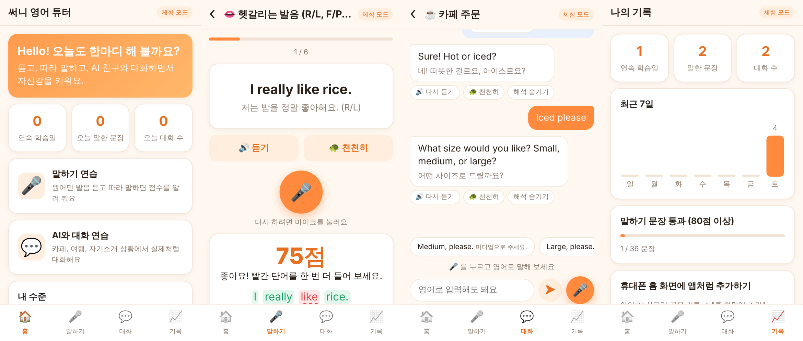

# 써니 영어 튜터 (AI English Tutor)

초보자를 위한 영어 **말하기 연습**과 **AI 대화 연습** 앱입니다.



웹 브라우저에서 동작하고, 휴대폰에서는 "홈 화면에 추가"로 앱처럼 쓸 수 있어요 (PWA).

## 무엇을 할 수 있나요?

| 메뉴 | 설명 |
|---|---|
| 🎤 말하기 | 6개 주제, 36개 문장. 🔊 원어민 발음 듣기 → 🐢 천천히 듣기 → 🎤 따라 말하면 **점수와 틀린 단어**를 빨간색으로 알려 줘요. |
| 💬 대화 | 자기소개·카페 주문·길 묻기·공항·쇼핑·자유 대화. AI 튜터 "써니"가 상대 역할을 하고, 매 대답마다 **한국어 해석**, **틀린 문장 교정**, **다음에 할 말 추천**을 보여 줘요. 마이크로 말하거나 글자로 입력할 수 있어요. |
| 📈 기록 | 연속 학습일, 최근 7일 학습량, 통과한 문장 수 (이 기기에만 저장). |
| 수준 선택 | 왕초보·초급·중급. AI가 수준에 맞춰 단어와 문장 길이를 조절해요. |

## 실행 방법 (컴퓨터)

[Node.js](https://nodejs.org) 18 이상이 필요해요.

```bash
cd ai-english-tutor
npm install
npm start          # → http://localhost:3000 열기
```

이 상태는 **체험 모드**예요. 말하기 연습은 그대로 다 되고, 대화는 미리 준비된 대본으로 진행돼요.

### 실제 AI와 대화하려면

[Anthropic Console](https://console.anthropic.com)에서 API 키를 만든 뒤:

```bash
# macOS / Linux
ANTHROPIC_API_KEY=sk-ant-... npm start

# Windows (PowerShell)
$env:ANTHROPIC_API_KEY="sk-ant-..."; npm start
```

오른쪽 위 배지가 **"AI 연결됨"**으로 바뀌면 성공이에요.
기본 모델은 `claude-opus-5-5`이고, `TUTOR_MODEL` 환경 변수로 바꿀 수 있어요. API 키는 서버에만 있고 브라우저로 보내지지 않아요.

## 휴대폰에서 쓰기

- 마이크(음성 인식)는 보안 연결(**https**)에서만 동작해요. 컴퓨터의 `localhost`는 괜찮지만, 휴대폰에서 `http://192.168.x.x:3000` 처럼 접속하면 마이크가 막혀요.
- 그래서 휴대폰에서 쓰려면 인터넷에 올려서 `https://` 주소를 받아야 해요. 이 저장소에는 [Render](https://render.com) 설정 파일(`render.yaml`)이 들어 있어요.
  1. 이 폴더를 GitHub 저장소에 올려요.
  2. Render에 GitHub로 가입한 뒤 **New → Blueprint** 에서 그 저장소를 골라요.
  3. `ANTHROPIC_API_KEY` 칸에 API 키를 넣고 **Apply** 를 누르면 `https://sunny-english-tutor-xxxx.onrender.com` 같은 주소가 생겨요.
  - 무료 플랜은 15분 동안 아무도 안 쓰면 잠들어서, 다음에 처음 열 때 30초 정도 걸려요.
- 접속한 뒤 홈 화면에 추가하세요.
  - 아이폰: 사파리 공유 버튼 → "홈 화면에 추가"
  - 안드로이드: 크롬 메뉴(⋮) → "앱 설치" 또는 "홈 화면에 추가"

### 지원 브라우저

| 기기 | 말하기(음성 인식) | 듣기(음성 출력) |
|---|---|---|
| 안드로이드 크롬 | ✅ | ✅ |
| 아이폰 사파리 (iOS 14.5+) | ✅ | ✅ |
| 컴퓨터 크롬·엣지 | ✅ | ✅ |
| 파이어폭스 | ❌ (글자 입력으로 대화 가능) | ✅ |

## 파일 구성

```
server.js              Node 서버 (정적 파일 + /api/chat AI 호출, 의존성은 Anthropic SDK 하나)
public/index.html      화면 뼈대
public/app.js          화면 로직, 음성 인식/출력, 발음 채점
public/style.css       디자인 (다크 모드 지원)
public/lessons.js      말하기 연습 문장 → 문장을 추가·수정하려면 여기를 고치세요
public/scenarios.js    대화 상황과 체험 모드 대본 → 새 상황을 추가하려면 여기를 고치세요
public/sw.js, manifest.webmanifest, icons/   휴대폰 앱(PWA) 설정
```

## 참고

- 발음 점수는 브라우저의 음성 인식 결과를 목표 문장과 단어 단위로 비교해서 매겨요. 정밀한 발음 분석(억양, 강세)은 아니에요.
- 음성 인식은 브라우저가 제공하는 기능이라 크롬에서는 인터넷 연결이 필요해요.
